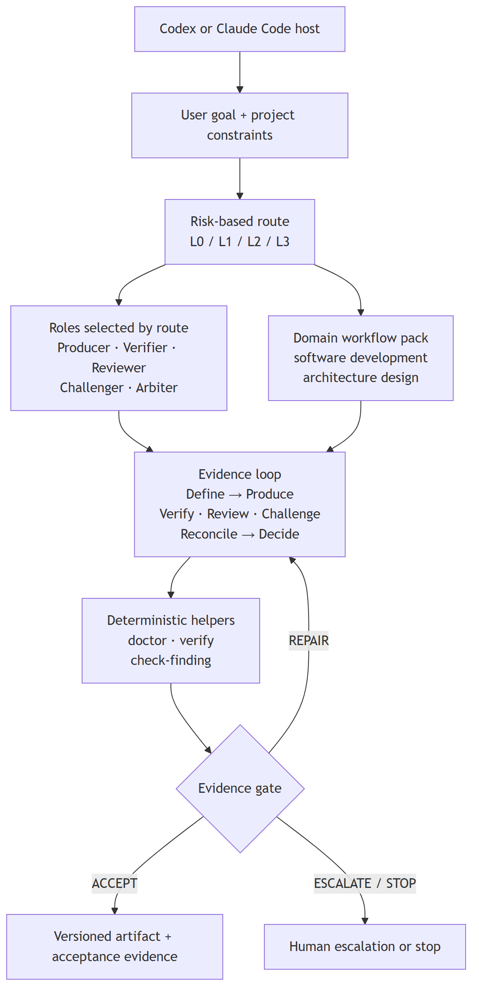

# Universal Work Loop Engine Kit v0.6.0

English | [简体中文](README.md)

Loop Engineering Kit is a lightweight control layer for AI coding agents. It
selects the smallest sufficient set of roles based on risk, then connects
execution, verification, independent review, and the acceptance decision with
evidence. Software development is the first runnable domain; architecture
design shows how the same protocol applies to non-code work.

## At a glance



In one sentence: **spend effort in proportion to risk, replace claimed
completion with executed evidence, and use an explicit gate to decide what
ships.**

## What it is—and is not

- **What it is:** a host-neutral protocol, five composable roles, two domain
  packs, adapters for Codex and Claude Code, and a dependency-free
  deterministic CLI.
- **What it solves:** as multi-role agent work grows, role sprawl, false
  completion, missing evidence, and uncontrolled repair loops become likely.
  This project makes those control points explicit.
- **What it is not:** a model runtime or a sub-agent launcher. Codex, Claude
  Code, or your own orchestrator still performs the work.
- **Current stage:** Stages 1-3 are complete. Persistent runtime storage,
  checkpoint/recovery, structured human approval, metrics, a version registry,
  and automated improvement candidates are implemented. See
  [`docs/PROJECT_STATUS.md`](docs/PROJECT_STATUS.md).

## Current implementation

- `core/`: the protocol, state machine, decision policy, and JSON Schemas
  (v3) for seven record types: Work Item, Artifact, Finding, Verification,
  Decision, Iteration, and Human Approval (`approval.schema.json`).
- `roles/`: five responsibilities: Producer, Verifier, Reviewer, Challenger,
  and Arbiter.
- `workflows/`: iterative delivery, adversarial review, and controlled
  continuous improvement.
- `packs/`: software development and architecture design. The software pack
  includes a reusable verification-skill template.
- `.codex/`, `.claude/`, and `adapters/`: role mappings for Codex and Claude
  Code.
- `loop_engineering/cli.py`: a dependency-free control plane for risk routing,
  deterministic verification, safe schema migration, persistent checkpoints and
  recovery, human approval, metrics, a version registry, and improvement
  candidates.

Stage 2 runtime and approval capabilities and Stage 3 metrics, registry, and
improvement candidates are implemented. Generated improvement candidates are
review inputs; they are never promoted automatically. The run registry treats
each Work Item plus record digest as one immutable provenance entry; identical
registration is idempotent, while conflicting label, commit, or run metadata is
rejected instead of overwriting the original.

Schema v3 also binds Artifact identity to a canonical `content_hash`.
Verification, Decision, and Human Approval records must repeat the matching
digest, so replacing the same `id@version` in place fails the gate.
L3 also records Producer, Reviewer, and Challenger session/model declarations
and requires distinct review/challenge sessions and models. These remain host
attestations, not cryptographic identity proofs.
Working-tree Artifacts can bind a Git revision and per-file SHA-256 values.
Human Approval and the final Decision also repeat a reviewed-set digest, so
editing criteria, Findings, or verification evidence after approval invalidates
both.

## Quick start

Windows PowerShell:

```powershell
py -3 loop_engineering\cli.py doctor
py -3 -m unittest discover -s tests -v
.\scripts\install.ps1 -Target Both -Scope User
```

If local execution policy rejects unsigned scripts, bypass it for this install
process only:

```powershell
powershell.exe -NoProfile -ExecutionPolicy Bypass -File .\scripts\install.ps1 -Target Both -Scope User
```

Ubuntu 22.04 Linux CI target (these commands are the CI target; local
compatibility is not claimed as evidence by this document):

```bash
python3 loop_engineering/cli.py doctor
python3 -m unittest discover -s tests -v
bash scripts/install.sh --target both --scope user
```

By default, `doctor` checks whether the Kit itself is complete. To check an
ordinary target project, use `--mode project`: a missing
`.loop-engineering.json` is allowed; an invalid config or check definition
fails.

After installation, validate the installed copy with `--mode installed`:

```powershell
python "$HOME\.agents\skills\loop-engineering\loop_engineering\cli.py" `
  doctor --mode installed --root "$HOME\.agents\skills\loop-engineering"
```

For Claude Code, replace the root with
`"$HOME\.claude\skills\loop-engineering"`.

The default user-scope install includes five roles and a self-contained
`loop-engineering` skill. It copies `core/`, `roles/`, `workflows/`, `packs/`,
and `loop_engineering/`, skipping existing files rather than overwriting them.
Merge `AGENTS.md` or `CLAUDE.md` into the target project manually.

To upgrade an existing install, pass the upgrade flag. The installer creates a
same-directory `.bak-<timestamp>` backup before replacing managed files and
moves the old `implementer` agent out of the active configuration after
backing it up:

```powershell
.\scripts\install.ps1 -Target Both -Scope User -Upgrade
```

```bash
bash scripts/install.sh --target both --scope user --upgrade
```

## How to use it

1. Install the adapter for your host in the target project.
2. Merge the rules from `AGENTS.md` or `CLAUDE.md` into the project
   instructions.
3. Run `python loop_engineering/cli.py route` to select L0-L3. Start only the
   roles required by that tier.
4. Choose a pack `pack.md` and define the Work Item, acceptance criteria, risk
   level, and repair budget.
5. Follow `workflows/iterative-delivery/workflow.md` through production,
   verification, review, challenge, reconciliation, and decision.
6. For software work, copy `.loop-engineering.example.json` to
   `.loop-engineering.json` in the project root and configure deterministic
   checks.
7. Run `python3 loop_engineering/cli.py verify --root . --report-dir
   <report-dir>` (use `py -3` on Windows). L1/L2 normally use a session
   temporary directory; use a project directory only when evidence must be
   retained or the route is L3.

Control tiers:

| Tier | Use when | Roles | Repair budget | Records |
|---|---|---|---:|---|
| L0 | Low-risk, isolated, unambiguous | Host edits and checks directly | 0 | none |
| L1 | Bounded single-file work | Producer, Verifier, Arbiter | 2 | compact |
| L2 | Multiple files, medium risk, or ambiguity | L1 + independent Reviewer | 3 | full (in session) |
| L3 | High risk or irreversible action | L2 + Challenger + human approval | 3 | audited |

Examples:

```powershell
py -3 loop_engineering\cli.py route --risk medium --files 2
py -3 loop_engineering\cli.py route --risk low --files 1 --trivial
py -3 loop_engineering\cli.py route --risk low --files 1 --irreversible
py -3 loop_engineering\cli.py route --risk medium --files 2 --max-repairs 20
```

`route` only prints the control policy; it does not modify the project.
`record_depth` governs the seven canonical records: Work Item, Artifact,
Finding, Verification, Decision, Iteration, and Human Approval. L0 requires no
multi-role records; L1 keeps a compact three-line goal/acceptance/budget brief;
L2 runs the full role loop but keeps records in session; only L3, or an
explicit project request, creates canonical record files.

Control-plane commands:

```text
migrate-records --dir <records> \
  --verification-role V-1=verifier --verification-role V-REVIEW=reviewer \
  [--write]
runtime-checkpoint --records <records> --store <store>
runtime-status --store <store> --records <records>
runtime-resume --store <store> --records <records>
approve --records <records> --artifact <artifact.json> \
  --approver <human> --statement <text> --confirm "APPROVE <id>@<version>"
metrics --dir <records> [--host-metrics <json>]
registry-update --store <store> --records <records>
registry-list --store <store>
improvements --dir <records>
```

JSON/Markdown files written by an explicit `verify` run are evidence reports,
not canonical role records. Use `--report-dir` to choose a session or project
location deliberately. A compact route does not become persistent because a
project asks for persistence; re-route to full or audited first.

Example verification config:

```json
{
  "version": 1,
  "max_repair_iterations": 3,
  "commands": [
    {
      "name": "unit-tests",
      "argv": ["{python}", "-m", "unittest", "discover", "-s", "tests", "-v"],
      "required": true
    }
  ]
}
```

`argv` must be an argument array; `shell=False` is the default.
`{python}` is replaced by the Python interpreter running the CLI. Only
configure commands you trust.

## Acceptance gate

`ACCEPT` requires explicit acceptance criteria, executed evidence for every
required check, no unresolved `blocking` or `high` findings, and resolution or
escalation of material disagreements. `BLOCKED` and `NOT_RUN` never count as
passing. L2/L3 require final-version Reviewer PASS evidence, each criterion
requires final-version Verifier evidence, and L3 additionally requires
Challenger PASS evidence plus a referenced `approve` Human Approval record.
The default repair limit is three iterations; at the limit, stop or escalate.
If the same failure fingerprint recurs without a new artifact version, stop or
escalate immediately.

## Boundaries

The host starts model sub-agents; this tool does not call models behind Codex
or Claude Code. Reviewer and Challenger independence depends on the host
providing an independent session.

The local test environment for this commit is Windows 11 with Python 3.12.
Windows and Ubuntu Linux with Python 3.8 and 3.12 are CI targets. Ubuntu is
pinned to 22.04 to retain a Python 3.8 runner. CentOS 8 is not covered by CI.
Until the remote workflow runs, these environments are targets, not evidence
of compatibility.

## Design rationale

The v0.6 routing, independent review, persistent checkpoint, human approval,
and stopping rules
draw on these engineering findings:

- Agentless shows that a simple, explainable locate-fix-verify path should
  remain the baseline.
- SWE-agent shows that tool and file interfaces change agent behavior.
- Rethinking Verification in Agent Harnesses finds that an independent
  reviewer usually offers a better accuracy-cost tradeoff than adding more
  completion checks.
- TurnCost finds that coding-agent cost is driven mainly by the number of
  turns rather than average observation length.
- Context as a Tool and The Hidden Costs of Forgetting show that context should
  be maintained as a working set and compression must account for repeated
  retrieval and cache costs.
- Why Do Multi-Agent LLM Systems Fail? shows that adding roles does not
  automatically improve reliability.

These figures are the papers' reports for specific models, tasks, and budgets,
not measured gains from this repository.

The first Claude Code routing comparison is recorded in
`evals/2026-10-28-claude-code-route-pilot.md`. It verifies protocol compliance
and cost only; it does not establish an improvement on complete coding tasks.
