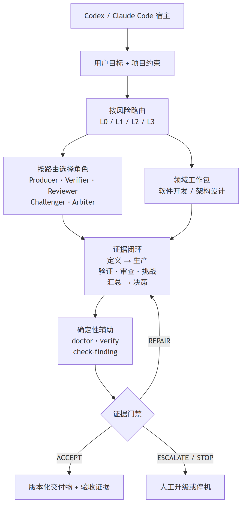

# Universal Work Loop Engine Kit v0.5.0

[English](README.en.md) | 简体中文

Loop Engineering Kit 是给 AI 编程 Agent 用的轻量控制层。它按任务风险选择
最小必要角色，把执行、验证、独立审查和验收决策串成一个有证据的闭环；
代码开发是第一个已实现领域，架构设计用于验证同一套协议也适用于非代码交付。

## 全景图



一句话：**用风险控制投入，用实际检查替代口头完成，用明确门禁决定交付。**

## 它是什么，不是什么

- **是什么**：一套宿主无关的协议、五个可组合角色、两种领域工作包、
  Codex/Claude Code 适配器，以及一个无第三方依赖的确定性 CLI。
- **解决什么**：多角色工作越复杂，越容易出现角色膨胀、假完成、证据缺失和
  返修失控；本项目把这些控制点显式化。
- **不是什么**：不是模型运行时，也不负责启动子 Agent；实际执行仍由 Codex、
  Claude Code 或你的编排器负责。
- **阶段状态**：v0.4 已实现路由、验证证据、决策校验和安装适配；持久化
  运行时、检查点/恢复、人工审批运行时、指标和自动改进仍未实现。

## 当前实现（阶段 1）

- `core/`：通用协议、状态机、决策策略，以及 Work Item、Artifact、
  Finding、Verification、Decision、Iteration 六类 JSON Schema（v3，验收标准
  以稳定 `criterion_id` 为键并与验证证据关联）。
- `roles/`：Producer、Verifier、Reviewer、Challenger、Arbiter 五类职责。
- `workflows/`：迭代交付、对抗审查、受控持续改进。
- `packs/`：软件开发和架构设计两个领域包；软件包包含可执行验证技能模板。
- `.codex/`、`.claude/`、`adapters/`：Codex 与 Claude Code 的角色映射。
- `loop_engineering/cli.py`：无第三方依赖的任务分级、环境检查和确定性
  验证报告工具；`check-finding` 校验 prevention 门禁，`check-records`
  解析跨记录引用和 Artifact/Iteration ancestry。

阶段 2 的确定性记录解析已实现；持久化存储、自动恢复和人工审批运行时仍未
实现。阶段 3（指标、版本注册、自动改进候选）也尚未实现。

Schema v3 是 breaking change。v1/v2 记录需先迁移；v3 新增 control tier、
route flags、Decision cycle、稳定 evidence refs 和 Verification role。

## 快速开始

Windows PowerShell：

```powershell
py -3 loop_engineering\cli.py doctor
py -3 -m unittest discover -s tests -v
.\scripts\install.ps1 -Target Both -Scope User
```

如果本机执行策略拒绝未签名脚本，可只在这一次安装进程中绕过策略：

```powershell
powershell.exe -NoProfile -ExecutionPolicy Bypass -File .\scripts\install.ps1 -Target Both -Scope User
```

Ubuntu 22.04 Linux CI target（命令如下；兼容性尚未作为本提交的本地验收证据）：

```bash
python3 loop_engineering/cli.py doctor
python3 -m unittest discover -s tests -v
bash scripts/install.sh --target both --scope user
```

`doctor` 默认检查当前 Kit 是否完整。在普通目标项目中检查可选配置时使用
`--mode project`：缺少 `.loop-engineering.json` 不算失败，存在但格式或检查项
无效则失败。

安装完成后，对安装副本使用 `--mode installed` 自检，不再要求源码仓库布局：

```powershell
python "$HOME\.agents\skills\loop-engineering\loop_engineering\cli.py" `
  doctor --mode installed --root "$HOME\.agents\skills\loop-engineering"
```

Claude 安装路径同理，将根目录换成
`"$HOME\.claude\skills\loop-engineering"`。

默认用户级安装五个角色和自包含的 `loop-engineering` Skill。安装器会复制
`core/`、`roles/`、`workflows/`、`packs/`、`loop_engineering/`，遇到已有
文件时跳过，不覆盖。
`AGENTS.md` / `CLAUDE.md` 仍需手动合并到目标项目。

从已有版本升级时显式传入升级开关。安装器会先为将被替换的受管文件生成
同目录 `.bak-<时间戳>` 备份，再覆盖；旧 `implementer` Agent 也会备份后
移出活动配置：

```powershell
.\scripts\install.ps1 -Target Both -Scope User -Upgrade
```

```bash
bash scripts/install.sh --target both --scope user --upgrade
```

## 使用方式

1. 在目标项目中安装对应宿主适配。
2. 将 `AGENTS.md` 或 `CLAUDE.md` 的规则合并进现有项目说明。
3. 先运行 `python loop_engineering/cli.py route` 选择 L0-L3；只启动该档位
   需要的角色。
4. 选择 `pack.md`，定义 Work Item、验收标准、风险等级与返修预算。
5. 按 `workflows/iterative-delivery/workflow.md` 完成生产、验证、审查、
   挑战、汇总和决策。
6. 代码域可将 `.loop-engineering.example.json` 复制为项目根目录
   `.loop-engineering.json`，配置确定性检查。
7. 运行 `python3 loop_engineering/cli.py verify --root . --report-dir
   <报告目录>`（Windows 用 `py -3`）。L1/L2 默认使用会话临时目录，只有需要
   长期保留证据或 L3 时才写入项目目录。
8. 冻结角色记录后运行 `python3 loop_engineering/cli.py check-records --dir
   <记录目录>`（Windows 用 `py -3`），校验 Work Item、Artifact、Finding、
   Verification、Decision 和 Iteration 的引用与版本 ancestry。

任务分级：

| 档位 | 场景 | 角色 | 返修预算 | 记录深度 |
|---|---|---|---:|---|
| L0 | 低风险、单点、无歧义 | 宿主直接修改与检查 | 0 | none |
| L1 | 有界单文件任务 | Producer、Verifier、Arbiter | 2 | compact |
| L2 | 多文件、中风险或有歧义 | L1 + 独立 Reviewer | 3 | full（会话内） |
| L3 | 高风险或不可逆动作 | L2 + Challenger + 人工批准 | 3 | audited |

例如：

```powershell
py -3 loop_engineering\cli.py route --risk medium --files 2
py -3 loop_engineering\cli.py route --risk low --files 1 --trivial
py -3 loop_engineering\cli.py route --risk low --files 1 --irreversible
py -3 loop_engineering\cli.py route --risk medium --files 2 --max-repairs 20
```

`route` 只输出控制策略，不修改项目。`record_depth` 管的是六类 canonical
角色记录：Work Item、Artifact、Finding、Verification、Decision、Iteration。
L0 不要求多角色记录；L1 只保留三行目标/验收/预算简报；L2 使用完整角色循环
但只保留会话内记录；只有 L3 或项目明确要求时才创建 canonical 记录文件。
显式运行的 `verify` 所写 JSON/Markdown 是证据报告，不属于上述六类记录；
因此应通过 `--report-dir` 明确选择会话目录还是项目目录。
compact 路由不会因项目要求持久化而升级；如必须保留 canonical 记录，应先
重新路由到 full 或 audited。

配置示例：

```json
{
  "version": 1,
  "max_repair_iterations": 3,
  "commands": [
    {
      "name": "unit-tests",
      "argv": ["{python}", "-m", "unittest", "discover", "-s", "tests", "-v"],
      "required": true
    }
  ]
}
```

`argv` 必须是参数数组，默认 `shell=False`。`{python}` 替换为当前 CLI 使用的
Python 解释器。只配置你信任的本地命令。

## 验收门禁

`ACCEPT` 要求：验收标准明确；必需检查有实际执行证据；没有未解决的
`blocking`/`high` 问题；重要分歧已经按规则解决或升级。`BLOCKED` 与
`NOT_RUN` 永远不算通过。L2/L3 还必须引用最终 Artifact 上状态为 `PASS`
的 Reviewer Verification，单独的 Reviewer Finding 不能证明审查完成。
每条验收标准还需最终 Artifact 上 role 为 `verifier` 的 PASS 证据；
仅仓库内冻结迁移清单与整组记录摘要同时匹配的历史记录可省略 role；
Producer 自验不能充当 Verifier。
默认最多返修 3 轮，达到上限后只能停止或升级。
如果同一失败指纹重复出现且 artifact 版本没有变化，立即停止或升级。

## 边界

宿主负责实际启动模型子 Agent；本工具不绕过 Codex/Claude Code 调模型。
Reviewer 和 Challenger 的独立性取决于宿主是否提供独立会话。本提交的本地
实测环境为 Windows 11 / Python 3.12；Windows 与 Ubuntu Linux 的 Python 3.8
和 3.12 是 CI 目标，Ubuntu 固定为 22.04 以保留 Python 3.8 runner；
Rocky Linux 8 容器使用 Python 3.8 覆盖 CentOS 8 兼容路径。远端工作流
实际执行前，这些环境不作为兼容性通过证据。

## 设计依据

v0.4 的任务分级、独立审查、上下文检查点和停机规则参考了以下工程结论：

- Agentless 表明简单、可解释的定位—修复—验证路径必须保留为基线。
- SWE-agent 表明工具与文件接口本身会改变 Agent 行为。
- Rethinking Verification in Agent Harnesses 发现独立 Reviewer 比单纯增加
  完成检查通常具有更好的准确率—成本折中。
- TurnCost 发现编码 Agent 的成本主要由回合数而非平均观察长度解释。
- Context as a Tool 与 The Hidden Costs of Forgetting 说明上下文应作为可维护
  工作集，且压缩必须计入重复取数与缓存成本。
- Why Do Multi-Agent LLM Systems Fail? 说明增加角色并不自动增加可靠性。

这里的数值均为论文在特定模型、任务和预算下的报告，不是本仓库的实测提升。

首次 Claude Code 路由对照记录在
`evals/2026-10-28-claude-code-route-pilot.md`。它只验证协议符合性和成本，
不代表完整编码任务的提升。Claude Code 适配器的本地验证路径使用
`qwen3.7-plus`；默认 GLM 路径曾返回上游 `403`，不应当作已验证默认值。
